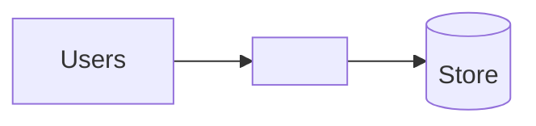

# Production handoff — <project name>

> Living document maintained by AI agents for the engineering team that will
> take this to production. Last updated: YYYY-MM-DD.

## 1. Summary

| | |
| --- | --- |
| **What it does** | <one or two sentences, business terms> |
| **Who uses it** | <users, internal/external> |
| **Business owner** | <name/team or Assumed/unknown> |
| **Technical owner** | <team or "open question"> |
| **Readiness** | Prototype · Ready for engineering hardening · Ready for production review |
| **Golden path** | <GP-n, language, framework> |
| **Biggest remaining gaps** | <top 3, one line each> |

## 2. Business context

Answers in the builder's own words. Source: **Confirmed** (asked) or **Assumed** (default).

| Question | Answer | Source |
| --- | --- | --- |
| Who uses it (Q1) | | |
| Scale (Q2) | | |
| Most sensitive information (Q3) | | |
| Impact if down for a day (Q4) | | |
| Other systems/data (Q5) | | |
| Lifespan (Q6) | | |
| Rules to follow (Q7) | | |
| Ownership (Q8) | | |

## 3. Derived requirements

| Requirement | Value | Standard | Derived from | Status |
| --- | --- | --- | --- | --- |
| Service tier | | NFR-01–03 | Q4 | Confirmed/Assumed |
| Data classification | | NFR-04 | Q3 | |
| Access model | | PAT-10, PAT-12 | Q1 | |
| Exposure | Internal / external via gateway | PAT-08 | Q1 | |
| Performance and scale | | NFR-05, NFR-06 | Q2 | |
| Retention | | NFR-08 | Q3, Q7 | |
| Compliance | | NFR-09 | Q3, Q7 | |
| Audit trail | | — | Q3, Q7 | |

## 4. Architecture as built

- Design: [`docs/design/<name>.md`](design/<name>.md) — or, with Spec Kit, per feature: spec [`specs/<NNN-feature>/spec.md`](../specs/<NNN-feature>/spec.md), plan [`plan.md`](../specs/<NNN-feature>/plan.md)

| Feature (Spec Kit) | Spec | Plan | Status |
| --- | --- | --- | --- |
| | | | Specified / Planned / Built / Reviewed |
- Structure: <modular monolith / services>, modules by business capability (PAT-20):

| Module | Responsibility | Path |
| --- | --- | --- |
| | | |

## 5. Infrastructure ports

Each external concern sits behind a port with a local adapter (zero setup)
and a production adapter (enterprise stack). Switching is configuration only (PAT-19).

| Port | Purpose | Local adapter | Production adapter | Config switch | Status | Owner | Effort |
| --- | --- | --- | --- | --- | --- | --- | --- |
| Persistence | | e.g. embedded DB | PostgreSQL (STK-30) | `DATA_STORE=` | Dev only / Ready | Engineering | S |
| Identity | | Dev login stub | Corporate IdP OIDC (PAT-10) | `AUTH_MODE=` | | Platform | |
| Secrets/config | | `.env` (local only) | Secrets manager (PAT-11) | | | Platform | |
| Messaging | | in-process | Kafka (STK-40) | | | | |
| <External system> | | Fake with sample data | <system API> | | | | |

Contract tests shared by both adapters: <path or Gap>.

## 6. Standards alignment

| Review | Date | Verdict | Notes |
| --- | --- | --- | --- |
| Architecture | | | |
| Readability | | | |
| Dependencies (`stack-check`) | | | |

## 7. Decisions and exceptions

| ADR | Decision | Type | Standards affected | Status |
| --- | --- | --- | --- | --- |
| | | Decision / Exception | | Proposed |

Builder preferences not followed (for context):

- <e.g. "Builder asked for MongoDB; PostgreSQL (STK-30) used — meets all stated needs.">

## 8. Production readiness gaps

| # | Gap | Area | Standard | Where | Owner | Effort | Status |
| --- | --- | --- | --- | --- | --- | --- | --- |
| 1 | | Security / Data / Observability / CI-CD / Ops / Code | | | | S/M/L | Gap |

Baseline checklist (mark each Ready / Gap / N/A):

- [ ] Production adapters implemented and contract-tested for every port (§5)
- [ ] Corporate IdP login and role checks on every endpoint (PAT-10, PAT-12)
- [ ] Secrets from secrets manager; nothing sensitive in repo (NN-01, PAT-11)
- [ ] Structured logs, traces, health endpoints, alerts for the tier (PAT-13, PAT-14)
- [ ] CI: lint, tests, dependency and licence scan, `stack-check --strict`, image build (AP-06)
- [ ] Database migrations versioned and backward compatible (PAT-18)
- [ ] Backups and restore tested for the tier (NFR-01–03)
- [ ] Data classification, retention and privacy controls applied (NFR-04, NFR-08, NFR-09)
- [ ] Runbook and on-call owner for Tier 1/2
- [ ] Security review if external or Restricted data

## 9. Open questions

| Question | For | Why it matters |
| --- | --- | --- |
| | Business / Architecture / Platform | |

## Change log

| Date | Change |
| --- | --- |
| | Handoff created |
